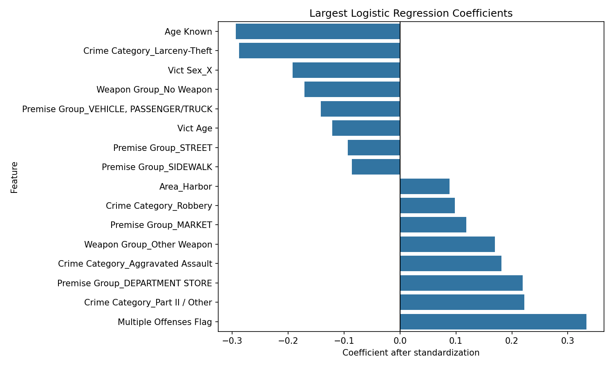
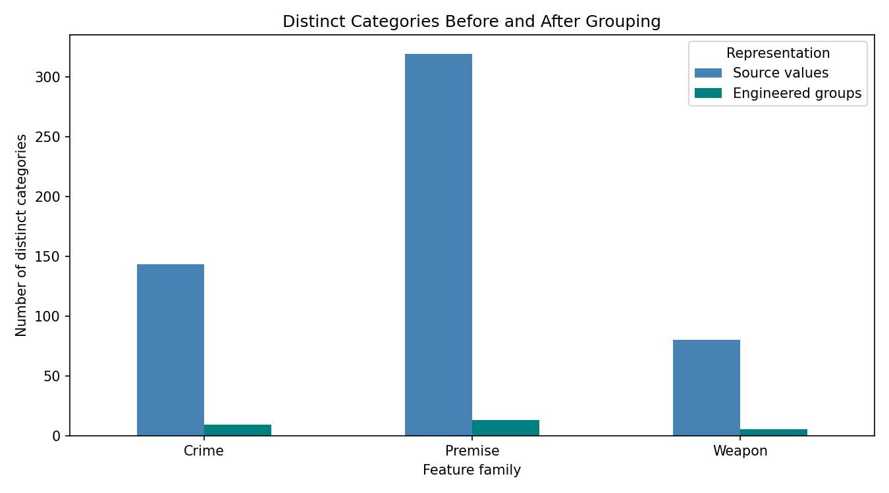
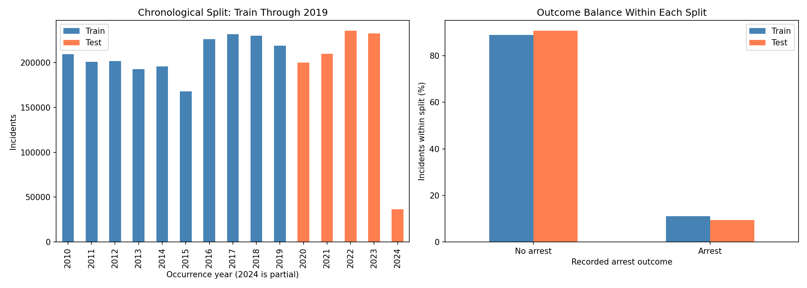
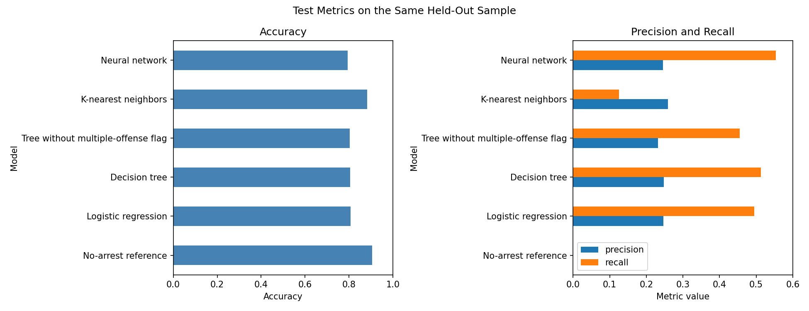
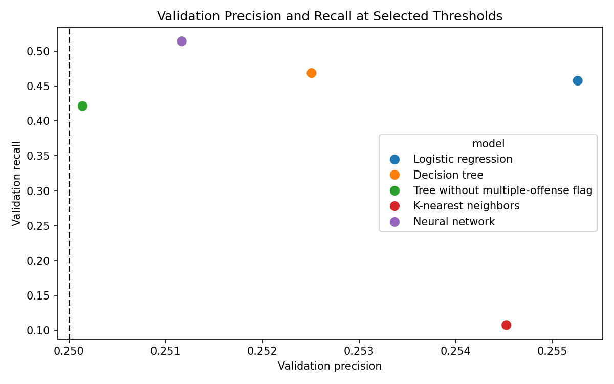
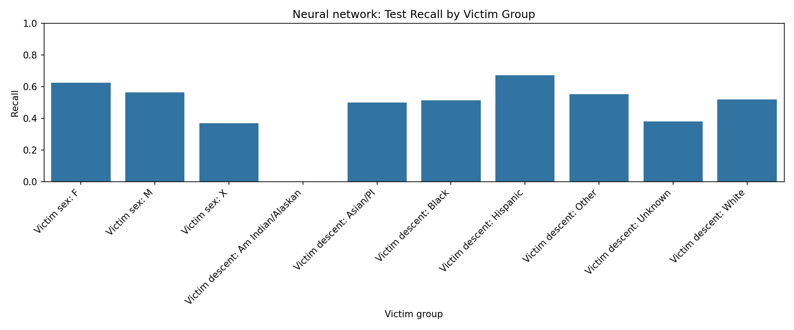

| | |
| --- | --- |
| **School:** | UC Berkeley Engineering |
| **Course:** | Professional Certificate in Machine Learning and Artificial Intelligence |
| **Session:** | April 2026 |
| **Assignment:** | Required Capstone Project 24.1: Final Report |
| **Project:** | Los Angeles Crime Arrest Analysis |
| **Student Name** | Ray Fuller, Ph.D. |
| **Date of Submission** | 29 October 2026 |

## Summary

This project asks which details of reported crimes in Los Angeles are related
to whether an arrest is recorded. It examines about 3 million crime records
from 2010 to early 2024, with an arrest recorded in roughly 1 in 10 records.
The best model in this comparison, a small neural network, uses patterns in
incident details to identify records likely to contain an arrest.
I compare the models on later records and check the selected model across
victim groups.

## What the data say

- **Nine in ten reported crimes have no arrest on record.** Across roughly 3
  million incidents from 2010 through February 2024, about 10.6% show an adult
  or juvenile arrest. That is a status in this copy of the data, not a final
  outcome, but it is lower than I expected.
- **The arrest share has been falling for a decade.** It peaked near 12.5% in
  2013 and 2014, declined through 2019, and has stayed below 9% since 2022. The
  sharpest drop came in 2020 and 2021, which lines up with the pandemic and the
  policing changes that followed, but the slide was already underway.
- **A recorded weapon roughly triples the arrest rate**, 19.2% versus 6.2%.
  Knives sit above firearms at the top of the list. One plausible reading is
  that knife incidents are close quarters with the suspect still present, but I
  did not test that. The source counts bodily force as a weapon, so this group
  is broader than armed crime.
- **Time of day matters more than time of year.** Arrest rates peak in the
  early morning hours, roughly 1 to 3 AM, and bottom out around midday.
  Month-to-month differences are small by comparison.
- **Police area spans 7.6% to 14.9%**, with Harbor highest. I read this as
  differences in the mix of crimes reported in each area, not as a measure of
  police performance.
- **Reports listing more than one offense are far more likely to show an
  arrest.** Part of this is probably circular: an arrest generates charges, and
  charges add offense codes to the report.
- **Incident details only weakly predict arrest.** The best model finds about
  55% of recorded arrests while being right roughly one time in four. What
  determines an arrest appears to lie mostly downstream of the report: witness
  cooperation, physical evidence, and whether a suspect is known or present.
- **The victim-group check did not point where the usual narrative would
  predict.** The model found arrests most reliably for incidents with Hispanic
  victims (recall 0.67) and least reliably where victim sex was recorded as X
  or descent as unknown (0.37 to 0.44). Unknown victim fields are common in
  property crimes with no one present, which are rarely cleared, so I read this
  as a data-quality pattern rather than a fairness finding. These are
  descriptive comparisons on historical records, not evidence about any
  individual or group.

## Research question

Which details about a reported crime in Los Angeles are related to whether an
arrest is recorded? I look at crime type, time, police area, type of place, weapon
involvement, victim details and whether more than one offense was listed.

A very high share of reported crimes never leads to a recorded arrest, and
raw arrest-rate comparisons across areas or victim groups can mislead because
different areas see different mixes of crime. A more careful look at which
incident details track with an arrest can help a records office, an analyst or
a city council member tell apart what is explained by the crime itself from
what is not, before drawing conclusions about location or demographics.

## Submission notebooks

Run in this order, using **Restart Kernel and Run All** for each notebook:

1. [Ingestion and cleaning](notebooks/01_ingest_clean.ipynb): raw sources,
   cleaning steps, duplicate checks, arrest labels and unusual values.
2. [Exploratory data analysis](notebooks/02_eda.ipynb): arrest-rate comparisons,
   plots, findings and limitations.
3. [Feature engineering](notebooks/03_features.ipynb): prepare model inputs using
   training data only, split by year and check the results with eight figures.
4. [Initial baseline](notebooks/04_model_baseline.ipynb): compare a
   simple logistic-regression model with an always-no-arrest reference and
   report accuracy, precision, recall and a confusion matrix.
5. [Model comparison](notebooks/05_models.ipynb): use chronological
   training/validation/test splits, choose model settings and thresholds using
   validation data only, compare five candidate models with a no-arrest
   reference, and check the validation-selected model across victim groups.

## Data and target

Data come from the City of Los Angeles Open Data Portal:

- [Crime Data from 2010 to 2019](https://data.lacity.org/Public-Safety/Crime-Data-from-2010-to-2019/63jg-8b9z)
- [Crime Data from 2020 to 2024](https://data.lacity.org/Public-Safety/Crime-Data-from-2020-to-2024/2nrs-mtv8)

The local CSV files are dated **July 26, 2026**. I keep incidents occurring from
January 1, 2010 through February 29, 2024, so 2024 covers only two months.
The portal says these older datasets are no longer updated following the change
to NIBRS, a newer crime-reporting system. Use the original downloaded files to
reproduce the same results; another copy may not be identical.

`Arrested=1` means adult arrest (`AA`) or juvenile arrest (`JA`).
`Arrested=0` includes investigation continuing (`IC`), adult other (`AO`) and
juvenile other (`JO`). Zero means **no arrest recorded in this copy of the data**,
not that an arrest will never occur. Older cases may have had more time to reach
an arrest than newer cases.

Large raw CSVs and Parquet files are deliberately excluded from Git.
The executed notebook outputs and figures are included for inspection without
downloading the data. The cleaning notebook documents how to rebuild the inputs.

## Run the analysis

### 1. Set up the environment

Use the package versions in [environment.yml](environment.yml). From the
repository root, with Conda installed:

```powershell
conda env create -f environment.yml
conda activate berkeley
python -m ipykernel install --user --name berkeley --display-name "Python (berkeley)"
```

If an environment named `berkeley` already exists, inspect it first instead of
creating or overwriting it. Select **Python (berkeley)** in each notebook's kernel
picker and select the same Python environment in VS Code. Using the wrong
environment can cause import errors even when the notebook code is correct.

### 2. Obtain the CSV inputs

Download CSV exports from the two source pages and place them in `data/` as:

```text
Crime_Data_from_2010_to_2019_20260726.csv
Crime_Data_from_2020_to_2024_20260726.csv
```

For the same row counts, use the original July 26 files. If using newer downloads,
record their actual download date and update the filenames in the cleaning
notebook rather than giving them the old date.

### 3. Execute

Run the five notebooks in order. They use paths relative to
`notebooks/`, and regenerate the cleaned data, feature tables and figures.
Open each notebook in order and use Restart Kernel and Run All.

The full dataset has millions of rows and the notebooks make several working
copies. Allow several minutes per notebook and sufficient memory.

## Cleaning and feature decisions

- Remove confirmed exact copies of records. If rows share an ID but have different
  values, stop and investigate rather than choosing one at random.
- Check dates, times, missing victim details, invalid ages and locations.
  Record how many rows each cleaning step affects.
- Keep long reporting delays that may be valid. Changing a plot's scale does not
  mean removing its records.
- Choose training years (2010-2019) and test years (2020 onward) before calculating
  any data-dependent preparation rules.
- Use training records to find the median age and 12 most common premises.
- Turn categories into 0/1 columns using the training categories. Test-only
  categories get zeros in that feature's columns, and their counts are reported.
- Save age, whether age was known, month, multiple-offense status and the
  category indicators. Each Parquet table contains those inputs plus
  `Arrested` and `DATE OCC`. The date is retained only as metadata to sort
  training records before validation; it is not a model input.
- Leave out case-status columns because they give away the arrest label. Also
  leave out raw descriptions, `Mocodes`, exact address and coordinates.
  Time-of-day and weapon groups replace exact hour and weapon flag. Year is used
  only for splitting. Reporting delay is plotted but not saved as a model input.

Code checks confirm that incident IDs are unique, the periods do not overlap,
both tables have the same numeric input columns and those inputs contain no
missing or infinite values. The arrest label stays separate from the inputs.

## Results

### Cleaning results

| Step | Rows removed | Rows remaining |
|---|---:|---:|
| Combine the two downloaded CSV files | 0 | 3,138,031 |
| Apply the February 29, 2024 occurrence-date cutoff | 91,247 | 3,046,784 |
| Exclude unsupported outcome statuses | 42 | 3,046,742 |
| Remove verified exact duplicates | 57,808 | **2,988,934** |

The removed duplicate rows were all from 2016. The final data have unique incident
IDs and no exact duplicate rows. Cleaning retained incidents with unknown ages:
**594,553** ages are missing after invalid placeholder ages are marked unknown. Zero-coordinate
locations were marked missing for **3,146** incidents rather than deleting those
incidents. No invalid HHMM times or negative reporting delays were found in the
retained data. HHMM stores hours and minutes, such as 1330 for 1:30 p.m.
The cleaning notebook explains the checks and counts.

### EDA findings

- **317,220 incidents (10.61%)** have an adult or juvenile arrest recorded;
  **2,671,714 (89.39%)** do not. Because one outcome is much more common, accuracy
  alone will not be enough to judge a future model.
- Observed police-area arrest rates range from **7.57% to 14.94%**, with Harbor
  highest. These rates do not account for differences in crime type and are not
  measures of police effectiveness.
- Recorded weapon involvement has a **19.15%** arrest rate, versus **6.24%**
  without recorded involvement. The source includes bodily force among weapon
  descriptions; the grouping is broader than firearms.
- The difference is **12.92 percentage points** (approximate 95% confidence
  interval: **12.83 to 13.00 points**) under an independent-record normal
  approximation. These historical records are not a random sample; the interval
  may understate uncertainty and does not adjust for time, crime mix or location.
- Crime category, premise, time and victim characteristics show descriptive
  differences. The notebook shows counts alongside rates. These patterns help
  choose possible model inputs.
- Most reporting delays are short, while a smaller number are much longer.
  I keep the long delays and show them on different scales rather than assuming
  they are mistakes.

### Feature-engineering results

| Check | Verified result |
|---|---|
| Training period | January 1, 2010 - December 31, 2019 |
| Training rows | **2,075,293** |
| Test period | January 1, 2020 - February 29, 2024 |
| Test rows | **913,641** |
| Training-only age median | **36 years** |
| Input columns before encoding | **12** |
| Numeric predictors after encoding | **73** |
| Columns per exported table | **75**, including `Arrested` and date metadata |

All cleaned incidents are included in one of the two periods; none appears in
both. Both saved tables have matching predictors and no missing or infinite
values. The saved occurrence date is used only to sort training rows before the
chronological fit/validation split. A separate check changed test ages and
premise categories and confirmed that this did not change the training median or
training premise groups.

There are **nine EDA figures** and **eight feature-engineering figures**, including
age-imputation comparisons, categorical reduction, encoding and split diagnostics.
The model-comparison notebook contains ten additional figures.

### Model results

The earliest 80% of the 2010–2019 training rows are used to fit models; the
latest 20% are used for validation. The validation sample has 20,000 rows. Model
thresholds are chosen to maximize recall while meeting a validation precision
target of 0.25.

Logistic regression and the decision tree use a small grid search with three
expanding-window folds on a 120,000-row training sample sorted by occurrence
date. Fold boundaries keep incidents from the same calendar day together. Grid
search uses mean accuracy, as in the course examples; it tunes parameters, but
does not select the final model. The separate validation period sets each
threshold and selects the model by recall at the 0.25 precision floor. Mean
cross-validation accuracy and selected settings are:

| Model | Mean CV accuracy | Selected settings |
|---|---:|---|
| Logistic regression | 0.691 | C = 10 |
| Decision tree | 0.677 | Depth = 8, minimum leaf = 100, gini, balanced weights |

The logistic-regression coefficients give a readable picture of what the
models are using. The multiple-offense flag is the strongest positive signal,
followed by Part II / other offenses, department-store premises and aggravated
assault. The strongest negative signals are a known victim age,
larceny-theft, victim sex recorded as X and no recorded weapon. I read the
positive group as incidents where a suspect is typically present or detained
on the spot: a store security hold, an assault with the parties still at the
scene, or a drug or weapons offense discovered during a stop. The negative
group is dominated by property crimes reported after the fact with no suspect
in view. The age result surprised me; incidents with a recorded victim age
are less likely to show an arrest, which I think reflects the same split,
since many Part II offenses have no individual victim and therefore no age.
The tree and the neural network cannot be read this directly, but their
validation and test scores track the logistic model closely, which suggests
they are leaning on the same handful of fields.



At the validation threshold, the neural network was selected with precision
0.251 and recall 0.514 at a threshold of 0.64. It leads the tree's recall
(0.469) on this validation sample; this is a sample-specific comparison, not
proof of broad superiority.

The final comparison uses the same random 50,000-row sample from the held-out
2020–February 2024 test period for every model. The training sizes differ by
model: logistic regression uses 1,660,234 rows, the tree uses 300,000, KNN uses
10,000, and the neural network uses a balanced 374,516-row sample. The network
uses early stopping based on validation loss.

| Model | Validation threshold | Accuracy | Precision | Recall |
|---|---:|---:|---:|---:|
| No-arrest reference | — | 0.905 | 0.000 | 0.000 |
| Logistic regression | 0.65 | 0.808 | 0.247 | 0.494 |
| Decision tree | 0.65 | 0.805 | 0.248 | 0.513 |
| Tree without multiple-offense flag | 0.64 | 0.804 | 0.231 | 0.455 |
| K-nearest neighbors | 0.31 | 0.882 | 0.259 | 0.125 |
| Neural network | 0.64 | 0.795 | 0.245 | 0.554 |

The neural network was selected using validation recall, not test results. On
the test sample, its precision is 0.245, below the target, despite recall of
0.554. The test period was examined in an earlier model comparison, so these
results are descriptive rather than an untouched final confirmation. The test
sample is only part of the held-out period, so its metrics may vary with the
sample.

### Victim-group check

The subgroup check uses the validation-selected neural network and the same
50,000-row test sample.

| Victim group | Rows | Recorded arrests | Precision | Recall |
|---|---:|---:|---:|---:|
| Sex: F | 18,149 | 1,892 | 0.233 | 0.626 |
| Sex: M | 20,579 | 2,026 | 0.255 | 0.564 |
| Sex: X | 11,272 | 851 | 0.256 | 0.370 |
| Descent: Am Indian/Alaskan | 52 | 2 | 0.000 | 0.000 |
| Descent: Asian/PI | 1,982 | 118 | 0.250 | 0.500 |
| Descent: Black | 7,039 | 635 | 0.234 | 0.513 |
| Descent: Hispanic | 15,020 | 1,890 | 0.241 | 0.671 |
| Descent: Other | 4,045 | 417 | 0.263 | 0.554 |
| Descent: Unknown | 11,756 | 932 | 0.262 | 0.381 |
| Descent: White | 10,106 | 775 | 0.242 | 0.520 |

The Am Indian/Alaskan group has only 52 sampled records and two recorded
arrests, so its metrics are especially unstable. The displayed subgroup results
use the validation-selected neural network; their differences are not adjusted
for other incident characteristics.

### Selected plots











## Recommendations and next steps

- **Treat the multiple-offense field as an outcome, not an input, in any
  future analysis.** It is recorded after an arrest adds charges, so it leaks
  the result it is meant to predict. The tree ablation shows recall drops from
  0.513 to 0.455 without it, which is a measure of how much of the model's
  apparent skill comes from that leak.
- **Improve victim-field completeness before drawing group comparisons.**
  Incidents with unknown victim sex or descent are the hardest to classify
  and are concentrated in property crimes. Any analysis of arrest disparities
  by victim group should first separate these records or report them as their
  own category.
- If the analysis continues, check which fields are available at the intended
  prediction time and remove or clearly justify fields that may be updated after
  the incident.
- Re-evaluate with a later, untouched time period and data that reflect current
  reporting practices. Compare precision, recall, and subgroup sample counts
  before making any broader claim.
- Keep model changes only when they improve the preselected validation criteria
  consistently. A larger neural network alone did not demonstrate a reliable
  advantage.

## Limitations and interpretation

These comparisons use recorded data, not a controlled experiment. Groups may
differ because of the crimes reported, how records are entered, policing or
missing information. Victim details do not describe offenders. Group rates cannot
tell us how an individual will behave or prove that an area or demographic trait
causes an outcome. The two months of 2024 should not be compared with a full
year's count.

The model comparison is retrospective, not a prospective prediction study. Some
report fields may be recorded or updated after an incident, and this analysis
does not verify that every input would be available at the time a prediction
would be made. Status can change after the snapshot. The held-out results are
based on a sample, and subgroup metrics can be unstable for small groups.

The victim-group check is descriptive, not a fairness certification. This
completes the planned classroom model comparison, not every possible analysis.
**Do not use these scores to make decisions about individuals, victims, or
police deployment.**

## Changes since Module 21

Since Module 21, I added the [model-comparison notebook](notebooks/05_models.ipynb).
It builds on the earlier cleaning, EDA, feature engineering and initial
logistic-regression baseline:

- Compare logistic regression, a decision tree, a tree without the
  multiple-offense flag, KNN and a small neural network with a no-arrest reference.
- Use chronological cross-validation to tune logistic regression and the tree,
  then use a separate validation period to choose thresholds and select a model.
- Compare all models on the same held-out test sample using accuracy, precision
  and recall.
- Check the validation-selected model across victim sex and descent groups,
  showing sample counts alongside the scores.

## Original proposal and scope

The [Module 16 proposal](docs/module16_problem_statement.txt) anticipated multiple
classifiers, spatial clustering and broader metrics. This report now includes
the planned logistic-regression baseline, a decision tree, KNN, a small neural
network, validation-based threshold selection, and a limited victim-group
performance check.

Spatial clustering and broader prospective validation remain
outside this report. The local course-material archive is reference material
and excluded from the project submission.
